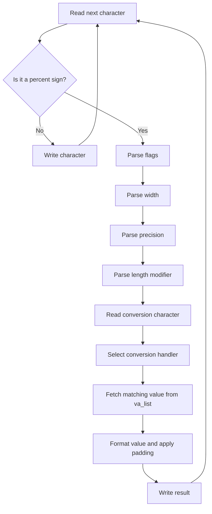

## A familiar function with a lot beneath it

For one of my EPITECH projects, I had to reimplement `printf` in C. The function looks simple when you call it: give it a format string and some values, and it prints the result. Building it made me realize how much work is hidden behind that small interface.

The format string is its own language. A conversion can include flags, a field width, a precision, and a length modifier before the actual conversion character. The implementation has to read that structure, fetch the right kind of argument from `va_list`, format it, and send it to the output.

## The parsing flow

I treated each `%` sequence as a small instruction. The parser reads its options in order and stores them in a specification structure. Once it reaches the conversion character, the program can choose the right handler and format the matching argument.

For example, in `%+010.2f`, the parser has to recognize the plus sign, a width of ten, a precision of two, and a floating-point conversion. Keeping those steps separate made it easier to reason about each option and to find bugs without turning the main loop into one giant block of conditionals.

## Building it in layers

I started with the simpler conversions, then added more of the format rules: signed and unsigned integers, strings, characters, bases, pointers, and the different length modifiers. Flags such as `-`, `+`, `0`, `#`, and the space flag interact with width and precision, so I had to be precise about when each one applies.

After that came the cases that needed extra care: dynamic width and precision with `*`, wide characters and strings, `%n`, and floating-point formats. The floating-point work included scientific notation, `%g` rules, and hexadecimal floats. Each new feature exposed cases that were easy to miss when looking only at ordinary examples.

## Testing the details

I compared my output with the system `printf` and built a test suite around the cases I had implemented. That comparison was especially useful for combinations of flags, precision, and length modifiers, where a result can look almost correct while still differing by one character or one space.

The project taught me to treat a large function as a collection of smaller responsibilities: parse the format, identify the conversion, retrieve the argument, build the output, and handle its width and alignment. By the time the tests matched the reference output, I understood much more clearly how variadic arguments and formatting rules work together in C.

## Conclusion

Reimplementing `printf` was one of the most demanding C projects I had worked on. It forced me to think carefully about parsing, types, edge cases, and tests instead of relying on a function whose behavior I had always taken for granted.

> “A format string is a tiny program, and `printf` is its interpreter.”
>
> — lluciocc
